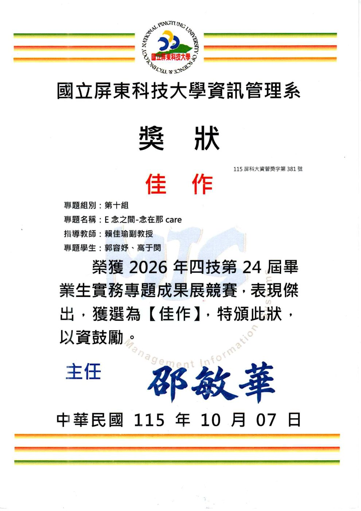

# E-CARE 警局端 Web

> 警察局緊急報案管理儀表板 — 即時案件監控、地圖視覺化、警員派遣操作與轄區推估。
>
> 🏆 **2026 臺灣數創大賞 數位+組 佳作**（經濟部產業園區管理局）
> 🏆 **國立屏東科技大學 第 24 屆畢業生實務專題成果展競賽 佳作**（2026-10）

---

## 專題簡介

E-CARE（Emergency Care）是一套面向偏鄉緊急報案的系統。民眾端 App 以語音報案，後端 AI 模型評估風險並結構化案情，警局端 Web 則是警方實際值勤使用的儀表板。

畢業專題第十組「E念之間－念在那care」，兩人分工：

| 成員 | 負責 |
|---|---|
| **高于閔**（本 repo） | **警局端 Web** — 案件地圖、風險排序、轄區與負責單位推估、派遣操作、狀態同步、部署 |
| 郭容妤 | 民眾端 App、AI 模型（ecare-v4）、FastAPI 後端 |

本 repo 是**純前端**專案，不含後端與 AI 模型程式碼。

---

## 技術棧

| 層級 | 技術 |
|---|---|
| 前端 | HTML5 + CSS3 + Vanilla JavaScript（**無框架、無 build step**） |
| 地圖 | Leaflet.js 1.9.4 + Leaflet.markercluster 1.5.3 |
| 底圖 | OpenStreetMap（電子地圖）/ Esri World Imagery（衛星圖） |
| 地理資料 | 內政部縣市、鄉鎮界線 GeoJSON（本地載入，離線可用） |
| 警政資料 | 警政署「各警察(分)局分駐(派出)所地址電話經緯度資料」1150304 版 |
| 備援定位 | Nominatim Geocoding API |
| 後端（他人負責） | FastAPI + PostgreSQL |

地圖涵蓋 **161 個分局**與 **1,687 個分駐（派出）所**，並建立 22 縣市的分局轄區對照。

---

## 三個主要頁面

| 頁面 | 功能 |
|---|---|
| **今日事件** | 案件地圖（群聚標記）、依風險排序的案件列表、縣市／鄉鎮互動圖層、統計圓餅圖 |
| **警員操作** | 案件詳情、派遣操作（救護／消防／警力）、處置狀態回寫、操作日誌 |
| **歷史紀錄** | 已結案案件查詢與狀態變更歷程 |

前端每 3 秒輪詢 `GET /reports`，以樂觀更新讓操作即時反映，再與後端對帳。

---

## 技術亮點

### 1. 座標四層備援 — 前三層不需要網路

案件沒有可用座標就會從地圖上消失，因此設計了逐層退化的定位機制：

```
① 資料庫 latitude / longitude     → isFinite() 排除 NaN / Infinity
② 從 location 文字正規表達式萃取   → 台灣範圍驗證（20–27°N, 118–125°E）、順序顛倒自動對調
③ 本地鄉鎮 GeoJSON 近似中心點      → 抽樣約 30 個頂點，複雜度 O(n) → O(30)
④ Nominatim 外部 Geocoding        → 佇列化，間隔 1200ms 避開 rate limit
```

**實際意義**：App 端在山區拿不到精確 GPS、只送出地址文字時，案件仍能標在鄉鎮層級，不會從地圖上消失 — 這正是偏鄉情境最常發生的狀況。

### 2. 找出並修正跨端狀態同步落差

後端原本只在收到民眾端四種狀態時更新 `case_records.status`，警局端送出的「已處理」／「誤報」只寫進 `incident_status_log`，主表狀態一直停在「處理中」。前端的樂觀更新讓畫面看起來正常，**把問題藏了起來**，只有換一台電腦開啟才會發現案件又變回處理中。

查資料庫確認影響範圍：

- 警方處置紀錄 **16 筆**，同步到主表 **0 筆**，影響 **7 件案件**，最早一筆在 5 月
- 其中一件被重複按了 4 次「已處理」，另一件結案後又被標成「誤報」 — 都因為畫面沒有正確顯示已結案

修正分三處：後端把狀態拆成「警方處置」與「民眾回報」兩組，民眾回報不得覆蓋警方處置；資料庫以最後一次處置回補 7 件案件（回補前備份）；前端原本散落 **7 處、寫法不一致**的「已結案」判斷統一成 `isClosedStatus()`。

### 3. 分語境 XSS 跳脫

案情描述、地址等欄位來自語音辨識與使用者輸入，依插入位置分別處理 HTML 內文、屬性值與 URL 語境，而非單一一套跳脫函式。

### 4. 轄區判斷與負責單位推估

單位屬於哪個分局直接採用原始資料的階層順序，不自行猜測；案件由誰負責則依座標與轄區推估，並在 UI 上標明為推估值。過程中修正了來源資料的 X/Y 對調、經緯度誤填、縣市欄位空白等異常。

---

## 畫面

<!-- TODO: 補上系統截圖 -->

---

## 專案文件

| 文件 | 內容 |
|---|---|
| [E-CARE_專案文件.md](E-CARE_專案文件.md) | 功能、UI、資料流、頁面行為的完整說明 |
| [E-CARE_警局端技術文件.md](E-CARE_警局端技術文件.md) | API 契約、整合落差與處理紀錄（寫給協作者） |
| [E-CARE_專案內容與偏鄉應用.md](E-CARE_專案內容與偏鄉應用.md) | 專題定位與偏鄉應用情境 |

---

## 本機執行

純靜態專案，不需要安裝任何套件：

```bash
# 以任何靜態伺服器開啟 Index.html
# VS Code Live Server（預設 port 5500）即可
```

案件資料需要後端 `GET /reports` 才會出現；僅開啟前端時，地圖、警察局所標記與縣市鄉鎮圖層仍可正常瀏覽。

---

## 得獎證明

| 獎項 | 頒發單位 | 日期 | 證明 |
|---|---|---|---|
| 2026 臺灣數創大賞 數位+組 **佳作** | 經濟部產業園區管理局 | 2026 | [PDF](得獎證明/2026臺灣數創大賞%20佳作證明.pdf) ・ [圖片](得獎證明/預覽圖/2026臺灣數創大賞%20佳作證明.jpg) |
| 2026 臺灣數創大賞 **入圍決賽** | 東海大學 | 2026-10-16 | [PDF](得獎證明/「2026臺灣數創大賞」入圍決賽.pdf) ・ [圖片](得獎證明/預覽圖/「2026臺灣數創大賞」入圍決賽.jpg) |
| 第 24 屆畢業生實務專題成果展競賽 **佳作**　←　本專題 | 屏科大資訊管理系 | 2026-10-07 | [PDF](得獎證明/國立屏東科技大學資訊管理系_專題競賽-佳作.pdf) ・ [圖片](得獎證明/預覽圖/國立屏東科技大學資訊管理系_專題競賽-佳作.jpg) |
| 2025 全國電腦輔助設計製造競賽 設計組 **第一名** | 東南科技大學 | 2025-12-11 | [PDF](得獎證明/2025全國電腦輔助設計製造競賽-第一名.pdf) ・ [圖片](得獎證明/預覽圖/2025全國電腦輔助設計製造競賽-第一名.jpg) |
| 2025 技職盃黑客松競賽 南區分區賽 **入選** | 教育部 | 2025-04-20 | [PDF](得獎證明/教育部獎狀-入選證明.pdf) ・ [圖片](得獎證明/預覽圖/教育部獎狀-入選證明.jpg) |
| 2025 技職盃黑客松競賽 全國賽 參賽證明 | 教育部 | 2025-05-24 | [PDF](得獎證明/教育部「2025年技職盃黑客松競賽」全國賽參賽證明書.pdf) ・ [圖片](得獎證明/預覽圖/教育部「2025年技職盃黑客松競賽」全國賽參賽證明書.jpg) |
| TSMC DIF 機台基礎 課程參與（32 小時） | 台灣積體電路製造股份有限公司 | 2026-01 | [PDF](得獎證明/台灣積體電路製造股份有限公司_DIF機台基礎-課程參與證明.pdf) ・ [圖片](得獎證明/預覽圖/台灣積體電路製造股份有限公司_DIF機台基礎-課程參與證明.jpg) |
| 系學會攝影 感謝狀 | 屏科大資訊管理系 | 2026-10-05 | [PDF](得獎證明/系學會任期內擔任攝影.pdf) ・ [圖片](得獎證明/預覽圖/系學會任期內擔任攝影.jpg) |

### 本專題獎狀



專題組別第十組　｜　專題名稱「E 念之間-念在那 care」　｜　指導教師 賴佳瑜 副教授　｜　專題學生 郭容妤、高于閔

### 2026 臺灣數創大賞 佳作


隊伍「火炬之光」以「離線韌性通訊與 AI 應急協作平台」獲數位+組佳作（成員：蘇柏誠、高于閔、郭容妤）。本專題處理的偏鄉緊急通報情境，是該作品的延伸基礎。

---

## 關於我

高于閔 ｜ 國立屏東科技大學 資訊管理系

| 時間 | 經歷 |
|---|---|
| 2026 | 臺灣數創大賞 數位+組 **佳作**（經濟部產業園區管理局）、入圍決賽 |
| 2026-10 | 第 24 屆畢業生實務專題成果展競賽 **佳作** — 本專題 |
| 2026-01 | TSMC DIF 機台基礎課程 32 小時 |
| 2025-12 | 全國電腦輔助設計製造競賽 設計組 **第一名** |
| 2025 | 教育部技職盃黑客松競賽 南區分區賽入選、全國賽參賽 |
